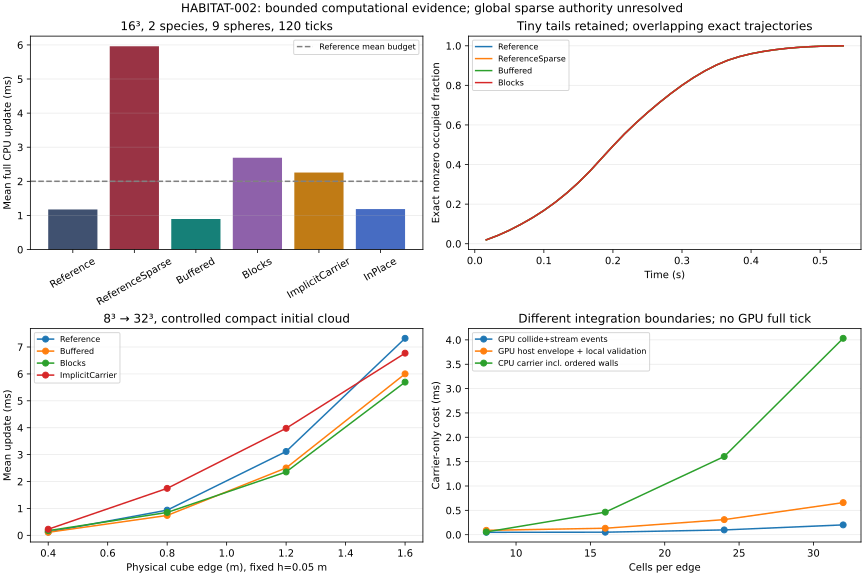

# HABITAT-002 — The Scalable Atmosphere

2026-11-27 America/Toronto. **PARTIAL.** Buffered dense CPU is a qualified bounded
experimental acceleration. A production sparse atmosphere and complete GPU
atmospheric update are **not qualified**. All source remains isolated within
HABITAT; no new architecture becomes canonical through publication. MORPH-005
remains PARTIAL, conventional stabilization paused; MORPH-006 stays suspended.

Clean source `0d2bd8990860e6f1fee6166fa4c7bdc42958551f`. Full workspace: **283 passed,0 failed,0 ignored**.
168 final CPU cases,133 independent equivalent-run comparisons over35 physical
input groups; every compared tick digest and decoded initial/final state matches.
All CPU cases assert their own every-tick replay. No CPU case execution failure.
Four ordinary native runs and a corrected360-tick render-overlap run reproduce
complete headless checkpoints. One failed contention protocol is retained below.

## Implementation and authority

`primordial::Chamber` remains the sole environmental commit authority. Explicit
`step_candidate(lane,Workspace)` selects B/C/D/F; default `step` remains reference A.
Workspace contains derived buffers/cache/activity, not authoritative inventories.
New `Mass::Blocks` extends existing scalar ownership. No new material/coordinate/
history/environment service, ship adapter, external solver import or dependency
stack was installed. Canonical ship runtime/collision/habitat guard/emission/
anatomy/filament/nursery laws are unchanged.

Changed sources: `crates/moebius-morph/src/primordial/{mod,transport,blocks,scalable,
scalable_tests}.rs`, `examples/habitat_scaling.rs`, shared allocator monitor
`examples/support/habitat_alloc.rs`, existing `habitat_environment` monitor import,
Cargo example declaration and existing lab `src/bin/habitat-witness.rs`.
`python/habitat_002_gpu.py` and `habitat_002_multiresolution.py` are detached probes,
not another environmental authority. Source commit29files/3540 additions/91deletions.

[Containment and preregistration](HABITAT-002_PROTOCOL.md) includes inspected reuse
matrix, acceptance and hard exclusions; [donor archaeology](HABITAT-002_DONOR_ARCHAEOLOGY.md)
and [licensing/provenance](HABITAT-002_LICENSE_AND_PROVENANCE.json) retain exact
versions, selected-text access, failed access and no-import rulings. Research
claims and local outcomes remain distinct. Source revision and complete commands
are in the [clean-source receipt](HABITAT-002_VALIDATION.json).

## Exact CPU results and original baseline

Reference workload:0.8m cube,16³,two species,nine inert spheres,120 ticks, fixed
16,666,667ns. Same gravity/initialization as001. Independent decoded comparison
confirms original001, fresh original repeat and current reference initial/final
states are exactly equal; historical checkpoints were not migrated or admitted
under a new source identity.

The published001 mean1.077040ms/P991.095660ms was reconciled from its archived
trace. A fresh restored **original001 executable** measured mean
1.206125ms on this run. It has its own
captured source8498c22/harness and is kept separate from current A, whose optional
attribution wrapper and expanded representation enum are compiled differently.
Timing variability is preserved; the old number is not relabeled a fresh result.

| Current lane | Mean ms | P99 ms | Cold first ms | Counted requested bytes/tick | 2ms mean /4ms P99 |
|---|---:|---:|---:|---:|---|
| Reference | 1.173604 | 1.225429 | 1.330409 | 3,114,001.0 | PASS |
| ReferenceSparse | 5.960298 | 6.625027 | 5.970727 | 3,551,213.8 | FAIL |
| Buffered | 0.894063 | 0.921569 | 1.213669 | 543,763.6 | PASS |
| Blocks | 2.690566 | 2.918949 | 3.055699 | 1,414,242.5 | FAIL |
| ImplicitCarrier | 2.257422 | 2.292829 | 2.628339 | 1,794,095.3 | FAIL |
| InPlace | 1.185348 | 1.231229 | 1.520979 | 539,223.9 | PASS |

B is1.313× the current reference speed and1.349× the fresh original001 speed,
with**82.538percent fewer requested bytes** than current A. It passes the registered
>=10percent steady-time OR >=50percent requested-byte improvement and the retained
reference budget. Mean components: clone0.011132ms, coupling0.001285ms,
carrier0.301835ms, transport0.277436ms, validation0.292192ms. Guards are retained;
validation is now a major residual cost. No claim of production organism/collision
coexistence follows from this standalone budget.

F passes allocation improvement and reference timing budget, but is about1percent
slower than current A and substantially slower than B. It saves544,768bytes of named
resident scratch versus B at16³ by replacing a streaming population buffer with
visited flags/carry. Both committed and tentative State still exist. This is an
accepted exact storage experiment, **not a demonstrated latency acceleration**.
C saves54.584percent requested bytes in the full demo but fails its2ms mean budget;
D fails both improvement and mean budget. Neither is selected as a general
acceleration. Original cell-tree sparse control is retained despite its regression.

[Machine-readable scaling](HABITAT-002_SCALING.json) reports all168 cases: mean,
median,P95,P99,max, cold and second-half steady costs, exclusive StepProfile
components, requested/live/peak allocator bytes, process high-water RSS, support/
slots/active blocks and transport cost per face. Counted builds are independent
from ordinary timing builds. Live/peak/RSS include harness/checkpoint/trace memory;
named scratch bytes omit tentative State and D's transient maps. None is silently
substituted for physical-state-only residency. No allocation attribution build is
used as an ordinary timing claim.

## Sparse regression, occupancy and blocks

[Attribution](HABITAT-002_ATTRIBUTION.json) partitions the **original transport** on
cloned diagnostic state; [method and missing metrics](SPARSE_TRANSPORT_ATTRIBUTION.md)
explain intrusive clocks. For the small-cloud32-tick control, ordinary A transport
averages0.191673ms versus original sparse1.558349ms. At tick16/support2914,
intrusive face discovery is0.0095ms dense versus2.0117ms sparse; nested sparse
ordered-set insertion0.7241ms and neighbor0.3422ms are included in that gross time.
Intrusive sparse apply is0.2786ms versus0.0049ms dense. Sparse lookups and ordered
entry accumulation also have measured counters/timers. These are instrumented
upper-bound diagnostics including recorder overhead, **not percentages of ordinary
runtime**. Gross phases must not be added to nested leaf times.

The initial target1percent is discretized to27/4096 seeded cells; support is81 after
the first step and4095 after32. Positive diffusion/flow expands exact nonzero
support until sparse storage pays near-dense work plus discovery/tree lookup/
allocation overhead. No tiny concentrations were removed. This is a measured
support-growth mechanism and timed implementation-path evidence, not a measured
hardware cache explanation. `perf` is unavailable; per-allocator API latency,
neighbor-only causal ablations and per-cell removal churn are NOT isolated.

C compares edge4/8/16/32 against original dense and cell-sparse storage, preserving
canonical face and accumulation order. All represented scalar/population/body/
impulse bits match. Exact-zero blocks can retire; the minimum subnormal is retained.
Zero retirement/reactivation is unit-tested synthetically, not a claim that real
clouds become inactive. At zero occupied mass the fastest measured C edge16 costs
0.599171ms steady versus B0.693271ms; no scalar blocks are allocated there, so that
single-host result cannot choose a production block size. At nonempty tested
occupancy points, best C steady cost is1.361–1.439ms versus B0.727–0.841ms. Their
support is almost/full by tick32. No interpolated sparse/dense crossover is inferred
from those evolving occupancies. C also retains dense carrier and scratch.

## Implicit atmosphere and physical extent

[D architecture/activation](CONSERVATIVE_CARRIER_ACTIVATION.md) derives one-link
substep dependencies and face-diagonal block communication from D3Q19. Implicit
cells retain finite density and all19 time-appropriate populations. IEEE BGK
background recurrence advances even in quiet regions. Velocity-only retirement
is explicitly falsified by a zero-velocity non-equilibrium perturbation. Missing
halo, subnormal culling and premature commit each fail assertions when injected.
Rendering and organisms never determine activation.

D's encode/evolve/decode adapter is physically exact in tested comparisons, but its
authoritative State remains dense. Encoding, decoded commit, dense diagnostics/
scalar sampling and a dense scan preserving original wall-impulse order remain.
This is the concrete blocking mechanism for domain-independent cost. No fully
sparse committed carrier/checkpoint/sampling architecture is claimed.

Domain enlargement is real: fixedh=.05m, N8/16/24/32 gives cube edges0.4/0.8/1.2/1.6m,
64× volume from smallest to largest, same compact2³ seed cells and16ticks. It is
not coordinate translation. B mean costs0.1117/0.7381/2.5042/6.0025ms; D
0.2266/1.7454/3.9781/6.7712ms. Largest D retains121 encoded active blocks out of512,
yet full cost remains dominated by the dense interface. This finite range does
not certify an enormous vessel. Separate fixed0.8m resolution controls also ran.

Region count, species0/1/2/4, diffusion0..0.001m²/s, perturbation speed, bodies
0/1/16/64/256 and workers1/2/4/8 were varied independently. Scoped collision
threads preserve every bit, but32³ B costs5.976/6.960/6.516/6.353ms for1/2/4/8 workers:
no multicore acceleration demonstrated. Per-step thread startup/post-buffer/
serial streaming and validation remain; no cache-counter conclusion follows.

## GPU and approximation lanes

Actual OpenCL RTX5060Ti FP64 execution succeeds despite NVML's library/kernel
mismatch. Capacity16,715,481,088bytes (15.57GiB). No driver changes. Own kernels use
strict CL1.2, FP_CONTRACT OFF, no reduced precision or relaxed math. Kernel/runner/
compiler/device identities and a fresh compiled-program fingerprint are retained.

| Grid | Collide+stream event mean ms | Host carrier+local-validation envelope mean ms | Requested device-buffer bytes | CPU comparison |
|---|---:|---:|---:|---|
| 8³ | 0.049287 | 0.089825 | 235,520 | exact final bits |
| 16³ | 0.051343 | 0.132418 | 1,884,160 | exact final bits |
| 24³ | 0.098197 | 0.309511 | 6,359,040 | exact final bits |
| 32³ | 0.201400 | 0.659009 | 15,073,280 | exact final bits |

Every120-step final population buffer equals its CPU reference bits at these four
grids; repeated same-device final execution and restored+3-step continuation are
exact. This does **not** prove per-tick cross-backend equivalence, cross-driver
portability or a whole GPU environmental state. CPU fields/spheres/ordered wall
impulses/global-inventory admission and full environmental transaction are not GPU
integrated. Three device-resident population-sized buffers plus status are reused;
only status downloads each step, with full populations at initialization/checkpoint.
Raw event/enqueue/sync/upload/download timings are retained. Requested device-buffer
bytes are not total measured VRAM, unavailable through failed NVML. A fast detached
carrier is not a qualified full atmospheric tick.

The first `gpu-32-with-render` protocol failed: suppressed Bevy logs caused its
adapter wait to end after rendering exited. Its kernel data remains valid, but it
is **not contention evidence**. Corrected `gpu-32-verified-overlap` retains19 process/
device samples proving concurrent execution and rendering alive at GPU completion.
Actual Bevy log/DRM identifies AMD Radeon610M/RADV PCI0000:10:00.0; OpenCL computes on
NVIDIA. This is **cross-device concurrent operation**, not same-GPU contention.
Corrected GPU host envelope mean0.670665ms;
rendered B mean0.952965ms. Same-NVIDIA-device render
qualification and complete-GPU-tick timing remain NOT RUN.

[G scalar interface](MULTIRESOLUTION_RESEARCH.md): coarse/fine60-cell finite-volume
transport versus uniform80-cell reference over4.00000008s. Mass drift2.220e-16kg per
unit area, L1 mass error0.083904 versus unit inventory. Restriction/prolongation
preserve mass while a two-child counterexample loses0.5 L1 subcell detail. No L1
acceptance threshold was invented afterward. No D3Q19 prolongation, viscosity/
stress matching, wave reflection/transmission, temporal subcycling or atmospheric
multiresolution acceleration is implemented or qualified.

## Challenges and evidence boundaries

| Challenge | Result |
|---|---|
| E01 equilibrium | Exact background/control including implicit BGK recurrence; no vacuum substitution |
| E02 single cloud | Exact CPU transport/finite inventories; support and costs recorded |
| E03 disconnected clouds | Independent region-count controls and two-cloud Witness; no biological activation |
| E04 block crossing | C scalar and D carrier halo comparisons exact, including sealed walls |
| E05 activation | Stencil-derived propagation exact; removed halo fails focused test |
| E06 retirement/reactivation | Synthetic exact-zero scalar retirement/reactivation and subnormal preservation; practical full-region deactivation UNRESOLVED |
| E07 saturation | Support grows to4096 cells, no threshold deletion; sparse overhead measured |
| E08 walls | Original ordered carrier/body impulses and scalar wall inventories preserved |
| E09 bodies | 0..256 body controls, demo and native full-state comparisons exact |
| E10 large extent | Fixed-cell-size0.4..1.6m chambers; global sparse scaling unqualified |
| E11 equivalence | 133 independent per-tick digests and decoded endpoint comparisons;35 physical groups |
| E12 approximation | GPU endpoint bits exact within preregistered tolerance; G scalar-only error retained, carrier interface NOT RUN |
| E13 replay/restoration | All CPU every-tick replay; execution/source/worker guards; GPU final-repeat/continuation; external archive restoration receipts |
| E14 failure/rollback | Capacity and injected late-backend refusal recover without committed mutation; real allocator OOM NOT INJECTED |
| E15 native contention | Four120-tick native/headless exact; failed overlap protocol retained; corrected360-tick cross-device overlap/headless exact |
| E16 sustained | Six2048-tick runs,34.133334016s physical time each; not unlimited lifetime |

Sustained mean full updates A0.9809ms, original-sparse3.3384ms, B0.7367ms,
C1.6501ms,D2.2027ms,F1.0467ms. Support grows81→4096; second-half B mean0.7401ms.
Across168 cases, maximum carrier residual3.925e-11kg, scalar residual1.034e-23kg,
accounted momentum norm9.981e-14kg·m/s; existing admission tolerances pass. This is
carrier+explicit-body momentum accounting, not statistical-particle momentum or
full thermal energy conservation. Physics closures/limitations remain001's.

Witness shows selected lane/scenario, block boundaries/allocation, scalar occupancy,
flow, configured bulk density/gravity, conservation and timing, named CPU scratch
and explicit GPU N/A for its CPU owner. Final Blocks/ImplicitCarrier captures were
inspected. Spatial carrier-density color mode, live GPU authority telemetry,
multiresolution level visualization and human control/aesthetic acceptance are
not established. Rendering only receives immutable state and derived activity.

## Acceptance, rejection and next dependency

| Lane/capability | Classification |
|---|---|
| A original001/reference | RETAINED; fresh original and current decoded state exact |
| B buffered dense CPU | IMPLEMENTED + VALIDATED bounded acceleration, explicit selection only |
| C local dense scalar blocks | IMPLEMENTED + VALIDATED exact representation; full-demo timing REJECTED; global sparse economy UNRESOLVED |
| D implicit carrier adapter | IMPLEMENTED + VALIDATED bounded exact kernel; full sparse residency/acceleration REJECTED for this adapter |
| E OpenCL FP64 carrier | IMPLEMENTED + VALIDATED detached final/replay controls; full atmospheric adoption RESERVED/UNQUALIFIED |
| F own in-place cycles | IMPLEMENTED + VALIDATED exact/buffer reduction; latency speedup NOT DEMONSTRATED |
| G multiresolution | IMPLEMENTED scalar-only probe; atmospheric capability RESERVED/UNRESOLVED |
| Approximate culling/mixed precision | NOT IMPLEMENTED; no hidden thresholds/precision changes |
| Canonical ship integration, organs, flagella, chemistry, thermal convection | EXCLUDED, unchanged |

Next authorized dependency is replacing D's dense authoritative storage/sampling/
validation/ordered-boundary interface with a versioned conservative sparse
representation under the same owner, or separately qualifying GPU whole-tick
integration. Those seams remain real work; neither is claimed solved by this
publication. Canonical adoption still needs separate Operator authorization.

## Reproduce and retain

See [precision/checkpoint contract](NUMERICAL_PRECISION_AND_REPLAY.md),
[dense optimization](DENSE_REFERENCE_OPTIMIZATION.md),
[block architecture](DENSE_BLOCK_ARCHITECTURE.md), and
[GPU feasibility](GPU_LBM_FEASIBILITY.md). Raw root:
`/home/cognis/habitat-002-20261127`. Final plan/commands/source fingerprints are in
`FINAL_PLAN.json`, `FINAL_RUNS.json`, `CERTIFIED_SOURCE_MANIFEST.json`,
`ORIGINAL_REFERENCE_REPEAT.json` and `VERIFIED_RENDER_OVERLAP.json`. The original
qualifier and its corrected follow-up remain separate files. Analysis/plot scripts
and standalone SVG/PNG/PDF figures are retained. Nine Python integrity tests,
formatting and strict all-feature Clippy pass;20 focused tests and four assertion-
failing/restored guards precede clean283-test regression. Hosted CI not inspected.

[Implementation storage](HABITAT-002_STORAGE.json):148files/388,342,313memberbytes,
immutable restore-verified Mermogon archive. [Final supplement](HABITAT-002_QUALIFICATION_STORAGE.json)
retains final traces, checkpoints, corrected failures, figures, GPU program and
Atlas snapshots. All per-file/archive/restore hashes are verified on volume UUID
D0A02EEBA02ED82C. Local copies and every previous001/archive version remain. Raw
bulk/cache directories do not enter Git; reports/provenance/figure/receipts do.
Restored matching B/C/D/F binaries reproduced all four full120-tick demo checkpoints.
The restored GPU script reproduced its archived payload and continuation exactly;
wrong CPU lane was refused with no output. Verification recipe/results are in the receipt.
Qualification:1142files/1,361,703,438memberbytes, archive SHA256
`6da69364615b2f2539e3b8353d054981319015a14bc8d34815d667b49d76a50e`.

Authorized source and publication commits are pushed after metadata review; actual
Git/remote SHA and clean state must be checked, not inferred from this report.
