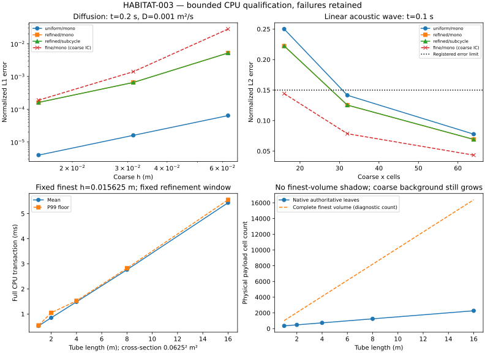

# HABITAT-003 — measured results

**PARTIAL.** Independent native FV/hierarchy/subcycling research is executable.
The clean source `5d69505236746f4e35d896824a83f217f1e4a5fb` passed **293 tests,0 failures/ignored**.
Ten focused new tests, two honest-red/restored checks, strict Clippy/fmt and five
independent Python auditor falsification tests pass. A copied-directive whitespace
gate initially failed and the shell continued; follow-up commit5d69505 corrected
it before clean broad validation. No history was rewritten.

## What actually ran

74 registered CPU runs: **73 completed,1 conservation rejection**. The rejected
adaptive-LBM step preserved the complete committed digest. All74 saved committed
endpoint partitions/inventories were independently recomputed from payloads.
Two independent100-cycle process runs have identical full digest traces and final
checkpoint bytes. All endpoints restore; completed runs compare one additional
monorate step after restoration. Each subcycle case also restores its first pending
half-cycle and finishes identically. These are distinct, bounded continuation proofs.
The reproduction recipe records the explicit integrator command; synchronized
checkpoints do not lock subsequent callers to one integrator. No bit-equivalence
between different numerical models is claimed.

Every-tick telemetry is retained. Only endpoint full payloads are independently
audited; not every tick has an independently reconstructed full payload. Maximum
admitted trace residuals: carrier 3.109e-15kg, scalar 9.529e-21kg, accounted momentum 1.753e-15kg*m/s. These tiny residuals do not prove accuracy.

## Numerical qualification

| Coarse x cells | Diffusion refined/mono L1 | Wave uniform L2 | Wave refined/mono L2 | Wave refined/subcycle L2 |
|---|---|---|---|---|
|16|0.005214088|0.250029130|0.222198906|0.222386462|
|32|0.000658589|0.141521773|0.125302654|0.125489880|
|64|0.000161797|0.077798709|0.069088888|0.069270586|

Wave error limit was0.15. All three n16 coarse/partially-refined wave controls
**FAIL**; their n32/n64 counterparts pass. Uniform-fine n16 error is0.144237837.
No threshold was changed. Acoustic damping is a measured limitation of this
first-order flux/model envelope. Periodic waves are not a localized reflection test.

Diffusion and shear errors decrease at three h in each of four spatial/temporal
settings. All registered diffusion/shear amplitude and advection-position bounds
pass. These are one-dimensional fields in3D cells; x length remains1m, transverse
length=2h. Analytic norms sample leaf centres; uniform-fine comparisons additionally
include unresolved piecewise-constant subcell variation. All24 matched fine-reference
comparisons are in SCALING, not silently treated as bit equality or identical norms.
Apparent modal viscosity is derived from the actual projected initial amplitude;
all twelve values and nominal0.005m²/s are retained in SCALING.

The uniformly fine controls are also initialized by constant prolongation of the
coarse sampled initial field, not by newly sampling the analytic sine on fine
centres. This keeps a common piecewise-constant initial field for the hierarchy
comparison. It introduces initialization error relative to the continuous analytic
control and can make the fine curve worse than the coarse curve in the centre-sample
norm. Uniform-fine trajectories are numerical references with that declared initial
condition, not exact solutions or evidence that finer solvers are intrinsically worse.

At fixedn32, subcycle shear L1 at dt0.0004/0.0002/0.0001 is 0.001021435299, 0.001021691786, 0.001021833337.
It slightly increases as dt decreases. Temporal-order qualification is unresolved;
spatial/temporal error cancellation is a hypothesis, not an established cause.
Weak hydrostatic speeds stay below1e-4m/s, but the changing transverse extent
prevents a same-box refinement claim. No exact well-balanced method is asserted.

## Conservation is not speedup

The32-cell refined shear monorate transaction mean/P99 is 0.536593/0.561122ms; subcycle is 2.946862/3.244950ms.
Subcycling is slower in this implementation. Repeated predictor reconstruction,
cloning and pending-work serialization are source-visible possible costs; causal
stage attribution for subcycling remains unmeasured. No speedup is claimed.

| Tube length m | Volume m³ | Native leaves | Complete finest cells, diagnostic only | Mean ms | P99 floor ms |
|---|---|---|---|---|---|
|1|0.003906250|352|1024|0.531081|0.549482|
|2|0.007812500|480|2048|0.852964|1.052313|
|4|0.015625000|736|4096|1.486666|1.527974|
|8|0.031250000|1248|8192|2.767494|2.825348|
|16|0.062500000|2272|16384|5.434034|5.550944|

Fixed fineh=0.015625m; actual tube cross-section0.0625²m²; fixed central
refinement window. Length/volume grows16fold from its own control. This is not an
isotropic ship and its largest volume0.0625m³ is smaller than the legacy0.8m-cube
demo0.512m³. Coarse background storage/work grows, and latency reaches5.43ms.
There is no O(1) infinite-universe result or comparable legacy acceleration claim.

The counted sustained case completed5000 cycles/1 physical second. Its live heap
before stepping is constant after20 warmup observations (range0bytes); all timing
observations are retained. Peak tracked live requests 4164615bytes; max requested bytes per transaction 4796864.
These exclude allocator overhead, total RSS, GPU memory and OS cache. Streaming
trace output prevents an in-memory history trend. This finite window is shorter
in physical time than00234.13s and is not lifetime evidence.

Fresh historical002 buffered baseline reproduced its complete checkpoint exactly:
mean0.97089935ms/P991.301043ms,120 observations. Historical publication
0.894063/0.921569ms remains distinct.003 timings involve different model/domain/
species/body workloads and cannot demonstrate acceleration of that demo.

## Required experiment matrix

Status applies only to the scope stated. NOT RUN is not PASS. Executed controls
with incomplete scientific proof are PARTIAL. Raw case completion is separate.

| ID | Status | Tested scope / exact missing dependency |
|---|---|---|
|E01|PASS|Bounded uniform/refined/subcycled equilibrium. Three equilibrium runs; speed<=1e-10, inventory budgets; focused equilibrium test|
|E02|PARTIAL|Weak gravity sampled hydrostatic profile. All max speeds below1e-4m/s; transverse extent changes with h, so no same-box spatial trend or exact well-balancing claim|
|E03|PASS|Analytical sinusoidal diffusion. 12 uniform/refined/fine controls, L1<=.15 and decreasing across three h|
|E04|PASS|Sinusoidal advection phase position. 12 controls; phase error<=one coarse h, measured rather than visually inferred|
|E05|PASS|Shear modal decay and spatial trend. 12 controls; amplitude error<=.15, decreasing L1; no complete compressible stress claim|
|E06|PASS|Accounted momentum transport on refined grids. Shear/disturbance/scalar-momentum focused test, all completed endpoints independently audited|
|E07|FAIL|Linear pressure wave accuracy across tested resolution envelope. Failed cases: wave-16-uniform-mono, wave-16-refined-mono, wave-16-refined-subcycle|
|E08|NOT RUN|Isolated reflection/transmission. Dependency: localized acoustic packet and separated reflected/transmitted reference; periodic-wave/fine comparisons do not substitute|
|E09|PARTIAL|Moving density-disturbance executions. Uniform/refined/subcycled pulses completed; isolated crossing/centroid reference not qualified|
|E10|PARTIAL|Two initial density disturbances. Three executions conserve and stay valid; interaction-specific quantitative reference missing|
|E11|PASS|Sealed FV wall impulse with weak gravity. Hydrostatic endpoint wall/source ledgers independently account momentum; FV free-slip differs from legacy LBM no-slip|
|E12|PASS|Existing passive-sphere regression only. Clean293-test suite includes original two_way_coupling_and_wall_impulses_close_momentum;003 bodies refused|
|E13|PASS|Repeated conservative remapping. 100 refine/coarsen cycles and focused inventory assertions; counters differ, microscopic replay not claimed|
|E14|PASS|One-dimensional spatial convergence controls. Three h for diffusion/shear/wave; not fixed-box3D convergence or universal order|
|E15|PARTIAL|Three subcycled dt settings. Fixed-h shear L1 slightly increases when dt decreases; temporal truncation not isolated from spatial error, no temporal-order qualification|
|E16|PARTIAL|5000-cycle finite sustained window. 1 physical second; conserved/stable, shorter physical duration than historical00234.13s; no lifetime/long-duration equivalence|
|E17|PASS|Native nonoverlapping leaf owner. Every saved endpoint independently partition-audited|
|E18|PASS|No parent/child duplicate physical inventory. Partition falsification; inspected source has no finest-volume authoritative shadow|
|E19|PASS|Coarse/fine synchronized inventory. Paired integrated interface register, endpoint audits and reflux honest-red|
|E20|PASS|Fixed2:1 conservative subcycling contract. Focused half-cycle/finish refusal tests; final accuracy and cost are separate|
|E21|PASS|Same-source process replay. Full100-cycle trace and final checkpoint exactly equal in two independent executions|
|E22|PASS|Complete synchronized checkpoint restoration. All74 saved committed endpoints restore exactly; one monorate continuation compared for completed runs|
|E23|PASS|Incomplete-cycle restoration. Every subcycle run restores its first pending half-cycle and finishes identically; focused pending continuation|
|E24|PASS|Invalid state and commit refusal. Injected numerical/finish refusal, conservation mutant and six adversarial checkpoint loads|
|E25|PASS|Logical leaf capacity refusal/recovery. Focused capacity32 test; no actual OS OOM, disk-full or GPU OOM manufactured|
|E26|NOT RUN|New-owner native Witness comparison. Dependency: native hierarchy/FV observation adapter and actual controlled stationary/moving captures|
|E27|NOT RUN|New-owner native Witness comparison. Dependency: native hierarchy/FV observation adapter and actual controlled stationary/moving captures|
|E28|NOT RUN|New-owner native Witness comparison. Dependency: native hierarchy/FV observation adapter and actual controlled stationary/moving captures|
|E29|PASS|Fixed-h actual tube enlargement. Length1/2/4/8/16m, cross-section0.0625²m², fineh0.015625m; not isotropic ship scaling|
|E30|NOT RUN|Fixed3D-box resolution scaling. Dependency: independent x/y/z extent controls; current x-resolution family changes transverse lengths|
|E31|PARTIAL|Fixed refinement volume in growing tubes. Central refinement window fixed; all coarse background and scalar tails retained; no fixed-active-gas sparse universe claim|
|E32|NOT RUN|Active-region count scaling. Dependency: disjoint-region physical scenarios and qualification protocol|
|E33|PASS|Bounded refined-volume fraction sweep. 0/25/100percent at matched roots/h/dt/physical extent; uniform/refined/fine cases and costs retained|
|E34|NOT RUN|Moving refinement overhead. Dependency: quantitative moving-indicator trajectory; hysteresis currently unit-tested only|
|E35|PASS|One/two/four passive scalar species. Matched refined diffusion100-cycle runs, inventories independently audited|
|E36|NOT RUN|Passive-body count. new003 closure not qualified; bodies refused|
|E37|NOT RUN|CPU workers. single-thread deterministic owner; no new parallel executor|
|E38|NOT RUN|GPU workload. complete environmental GPU transaction not implemented|
|E39|NOT RUN|Concurrent-rendering full transaction. new-owner Witness and full GPU transaction not implemented|
|E40|PARTIAL|Bounded requested-heap accounting. 5000 streamed ticks: live-before range0bytes after20ticks; requested allocator only, not total RSS/VRAM/page cache|

## Hypotheses

| Hypothesis | Verdict | Evidence boundary |
|---|---|---|
|H1|PARTIALLY QUALIFIED|Native spatial leaf controls conserve with fewer payload cells; coarse-wave error fails and general3D adaptive accuracy is open|
|H2|PARTIALLY QUALIFIED|Fixed2:1 cycles synchronize conservatively, but measured cost is higher and temporal accuracy order is unresolved|
|H3|PARTIALLY QUALIFIED|Paired flux and reflux contracts qualify bounded FV conservation; acoustic-interface scattering still NOT RUN|
|H4|QUALIFIED|Bounded experimental native ownership and persisted provisional work; no canonical integration|
|H5|PARTIALLY QUALIFIED|FV diffusion/shear/advection controls qualify; n16 wave controls fail, no calibrated full atmosphere|
|H6|UNRESOLVED|Conditional Knudsen arithmetic and donor dossier only; no hybrid solver|
|H7|NOT RUN|Full environmental GPU authority remains unimplemented|
|H8|PARTIALLY QUALIFIED|Physical jump/hysteresis state implemented and tested; moving-refinement adequacy/cost not qualified|

## Scientific verdict and next dependency

1. CONSULTED methods include conservative AMR/reflux, adaptive LBM, octrees, moving
meshes, particle/SPH/MPM/DEM/PIC/DSMC, multigrid/FMM, reduced models and event scheduling.
Forty donor records preserve twenty-plus fields, many UNKNOWN; two source/license
revisions were inspected, zero donor executables reproduced. This is an incomplete
donor qualification, not forty validated methods.
2. Directly relevant principles are unique integrated ownership, paired face exchange,
conservative synchronization, physical indicators and explicit provisional clocks.
3. Independently IMPLEMENTED: native two-level FV, authored failed adaptive LBM,
fixed2:1 FV subcycling and optional physical jump/hysteresis. No donor code/dependency import.
4. Bounded diffusion, advection, shear and inventory contracts qualify; coarse-wave
accuracy fails and localized scattering/general3D/temporal-order claims remain open.
5. All completed FV endpoint inventories and accounted momenta pass independent audits.
The LBM candidate fails and is refused, not repaired by normalization. No thermal-energy
conservation or resolved body/particle law is claimed.
6. Spatial payload count scales below a full finest volume in measured tubes; coarse
background remains costly. Temporal conservation is shown; temporal speedup is not.
7. Native FV monorate currently has the strongest local evidence for further native
hierarchy work. It lacks legacy body closure and must remain a competitor, not replacement.
8. Fundamental unresolved seams: acoustic interface scattering, calibrated regime/EOS,
general3D error, arbitrary-depth/time coupling, moving refinement, body coupling and GPU/Witness.
9. No hardware limit was isolated by exhaustion or GPU measurements in003. Current CPU
identity is archived; single-window timings do not establish a machine ceiling. Historical
GPU/driver observations remain002 evidence, not new003 results.
10. Architectural limits include two levels, explicit CFL, root-background ownership,
per-step face rebuilding/cloning, expensive pending validation and isothermal model form.
11. Chaste/PhysiCell/Morpheus/COPASI/IBAMR/phase-field/individual-based/neural projects
provide future leads for construction/genesis/ecology. All require their own material,
energy, reaction, birth/death and interface proofs; none is integrated biology.
12. Continue already-authorized003 work with genuinely3D/interface controls, lawful
shared body closure, one selected Witness owner and resident GPU transaction. Canonical
adoption, donor-code import and any new biological authority require separate decisions.

## Retention and non-claims

All failed/raw runs, traces, checkpoints, complete final source capsules/executables,
research/source excerpts, scripts, figures and Atlas snapshots are retained externally.
STORAGE and QUALIFICATION_STORAGE identify verified Mermogon immutable versions,
per-file hashes, restoration and actual restored execution. The restored final100-step
replay-control checkpoint also matches exactly. Pre-seal archived metadata snapshots
may show pending fields; published Git receipts/reports supersede those fields while
raw evidence stays immutable. Local directories are caches.
The three smoke pilots retain executable/hash identities but lack a complete pre-fix
source snapshot; final qualification has complete matching source capsules.

No full GPU environmental owner, new-owner native Witness captures or view-trajectory
equivalence, real OOM/driver exhaustion, arbitrary asynchronous clocks, new003 bodies,
chemical/gill/organism behavior or canonical ship integration is claimed. MORPH005 stays
PARTIAL/paused; MORPH006 suspended. See REPRODUCE for commands and limitations.
