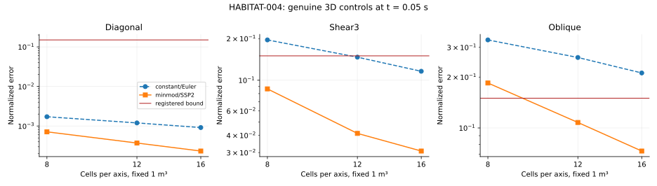
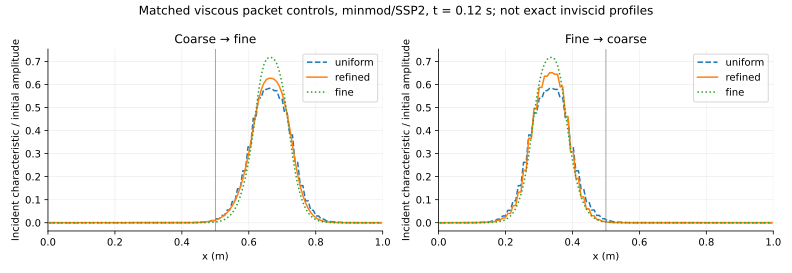
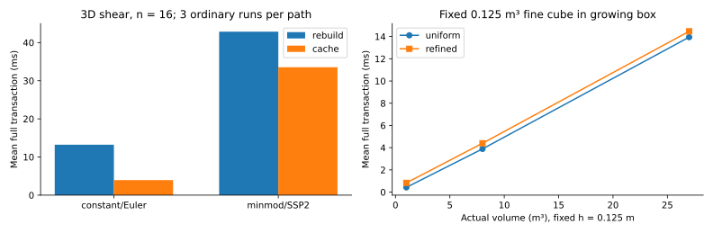

# HABITAT-004 — final bounded results

**PARTIAL.** Certified source `d9834e609f220d25e85cb937f69b186dbb94c1a7`; clean full suite **304 PASS, 0 failed, 0 ignored**. Final **121/121** registered executions completed. Execution, conservation and fidelity are separate: the acoustic family still fails at n8, and interface/dynamic/endurance limits remain visible below. No canonical/biology integration, full GPU FV, recursive owner, new body coupling or native Witness was added.

## Three-dimensional fidelity

Fixed 1 m³, n8/12/16 on every axis, t=.05s. Each family requires decreasing errors and all three errors≤.15. Diffusion/diagonal use normalized scalar L1, shear/manufactured vortex velocity L1, oblique wave density L2 relative to initial amplitude. The wave comparator solves a linear viscous system; full nonlinear model error remains. The vortex has a declared external force.

| Control / scheme | Error n8 | n12 | n16 | Trend / all within bound | Family verdict |
|---|---|---|---|---|---|
| Diffusion3 / reference | 0.000722409 | 0.000322142 | 0.000180021 | True / True | QUALIFIED |
| Diffusion3 / combined | 0.000726268 | 0.000326223 | 0.000184182 | True / True | QUALIFIED |
| Diagonal / reference | 0.0017173 | 0.00119822 | 0.000915094 | True / True | QUALIFIED |
| Diagonal / combined | 0.000712936 | 0.000371764 | 0.000233261 | True / True | QUALIFIED |
| Shear3 / reference | 0.195719 | 0.146853 | 0.1161 | True / False | REJECTED |
| Shear3 / combined | 0.0865857 | 0.0412659 | 0.0307621 | True / True | QUALIFIED |
| Oblique / reference | 0.332 | 0.261298 | 0.211591 | True / False | REJECTED |
| Oblique / combined | 0.184551 | 0.107745 | 0.0729962 | True / False | REJECTED |
| Vortex / reference | 0.133661 | 0.0997363 | 0.0787329 | True / True | QUALIFIED |
| Vortex / combined | 0.0679535 | 0.0340596 | 0.0203404 | True / True | QUALIFIED |

Combined wave error improvement over reference: 1.79896×, 2.42516×, 2.89865×. n12/16 pass their individual limits; the family is not wholly qualified. Diffusion gets no reconstruction benefit. Space/time ablations and empirical orders are in SCALING.json; no formal arbitrary-AMR order claim.

## Interface scattering

Matched durations .12s; homogeneous coarse/fine controls; fixed thin transverse periodic domain. Reflection subtracts the SAME upstream-resolution homogeneous state. Transmission compares homogeneous fine. Packet kinematic-Gaussian norms are not exact viscous-error measurements.

| Case | Excess reflected / incident | Transmission peak error | Phase (m) | Arrival (s) | Bounds |
|---|---|---|---|---|---|
| packet-32--1-reference-refined | 0.000217231 | 0.127023 | 0.015625 | 0.0019 | True |
| packet-32--1-combined-refined | 0.00102216 | 0.15174 | 0.015625 | 0.0032 | False |
| packet-32-1-reference-refined | 3.36862e-05 | 0.174055 | 0 | 0.0013 | False |
| packet-32-1-combined-refined | 4.06311e-05 | 0.197322 | 0 | 0.0002 | False |
| packet-64--1-reference-refined | 0.000223288 | 0.108626 | 0.0078125 | 0.0009 | True |
| packet-64--1-combined-refined | 0.000642306 | 0.0932184 | 0.0078125 | 0.0016 | True |
| packet-64-1-reference-refined | 2.87473e-05 | 0.150489 | 0.0078125 | 0.0008 | False |
| packet-64-1-combined-refined | 3.8229e-05 | 0.12644 | 0 | 0.0003 | True |
| narrow-64--1-combined-refined | 0.000493864 | 0.140997 | 0.0078125 | 0.0016 | True |
| narrow-64-1-combined-refined | UNRESOLVED | 0.191516 | 0 | 0.0001 | None |
| double-interface-64-reference | 5.56015e-05 | 0.143878 | 0 | 0.0007 | True |
| double-interface-64-combined | 3.20786e-05 | 0.120598 | 0 | 0.0018 | True |

`False` is a failed preregistered bound; null/UNRESOLVED is not PASS. Narrow rightward reflection lacks its matched coarse control. Multiple-interface actual slab [.40625,.59375]m. No oblique/moving-interface proof.

## Cost, hierarchy and physical duration

| Scheme | Mean paired speed ratio | Each paired ratio | Cache bytes |
|---|---|---|---|
| Constant/Euler | 3.35789 | 3.37187, 3.34605, 3.35576 | 720896 |
| Minmod/SSP2 | 1.27795 | 1.27687, 1.28562, 1.27135 | 720896 |

All six pairs: exact complete checkpoints and every tick digest, including three higher-order pairs. Cache adds explicit metadata; identity checks and full admission remain timed. No payload-layout change or local rebuild was tested.

| Case | dt (s) | Scalar normalized L1 | Transaction ms | Transaction seconds / physical second |
|---|---|---|---|---|
| temporal-coarse | 0.001 | 0.000914888 | 0.851056 | 0.851056 |
| temporal-fine | 0.0005 | 0.00091819 | 0.836902 | 1.6738 |
| temporal-subcycle | 0.001 | 0.000915282 | 12.7094 | 12.7094 |

Monorate uses the derived face cache; the original subcycle path rebuilds faces. This compares complete available paths, not isolated time integration with equal caching. Subcycle reconstruction/encoding overhead is independently attributed, non-additively, in TEMPORAL_COST_ATTRIBUTION.md. No optimized subcycle or full GPU atmosphere candidate exists.

| Case | Refinements / coarsenings | Leaves | Scalar error | Cache builds | Mean ms |
|---|---|---|---|---|---|
| physical-adaptation-False | {'refinements': 0, 'coarsenings': 0} | 512 | 0.021178 | 1 | 3.33142 |
| physical-adaptation-True | {'refinements': 256, 'coarsenings': 8} | 2248 | 0.026741 | 3 | 19.9557 |

Both dynamic and static controls meet the ≤0.15 scalar bound at 2.5 s. Adaptation nevertheless worsens error from 0.021178 to 0.026741 while increasing mean cost from 3.33142 to 19.9557 ms. This is a negative accuracy–cost result for these thresholds. The mesh performs 256 refinements and 8 coarsenings; localized region tracking is not established.

| Case | Actual volume m³ | Leaves | Fine volume m³ | Faces | Mean ms | Checkpoint bytes | Cache bytes |
|---|---|---|---|---|---|---|---|
| isotropic-8-uniform | 1 | 512 | 0 | 1536 | 0.429848 | 132448 | 90112 |
| isotropic-8-refined | 1 | 960 | 0.125 | 3024 | 0.830805 | 239969 | 177024 |
| isotropic-16-uniform | 8 | 4096 | 0 | 12288 | 3.88988 | 996082 | 720896 |
| isotropic-16-refined | 8 | 4544 | 0.125 | 13776 | 4.39655 | 1103939 | 807808 |
| isotropic-24-uniform | 27 | 13824 | 0 | 41472 | 13.947 | 3348104 | 2433024 |
| isotropic-24-refined | 27 | 14272 | 0.125 | 42960 | 14.4711 | 3456073 | 2519936 |

Actual isotropic volumes 1/8/27 m³, fixed h = 0.125 m, using equilibrium fields for cost scaling. Fine cube stays.125m³. Not a claim to enormous habitats or recursive depth. Checkpoint bytes are JSON encoded checkpoints, cache bytes estimates. Sustained3D:5,000 cycles, 2.5 s; allocation-instrumented result is separate from ordinary timings. Heap {"steady_live_range": 0, "max_peak": 6598505, "max_requested_per_transaction": 3422102, "scope": "requested allocator only, not totalRSS/VRAM"}; scalar normalized error 0.021178.

## Integrity, persistence and boundaries

Independent endpoint inventory/partition audits: True; all restores True, continuations True, process replay True. Maximum independently recomputed analytic discrepancy 1.77636e-12; initial packet Gauss4/8 discrepancy 1.07768e-08. Peak per-tick mass residual 1.05871e-12kg, momentum-component residual 3.40838e-14kg·m/s, scalar residual 7.20994e-18kg. Tolerances unchanged.

19 focused Rust tests, 2 hardware tests, 5 independent Python integrity tests; 4 deliberate mutants failed and restored tests passed. Natural minmod underflow defect fixed before qualification. Strict workspace Clippy/fmt passed. Full clean suite304 PASS. Eleven historical checkpoints reproduced; default first-order encoded physical state equals003 after declared metadata/zero-ledger removal. Old001–003 artifacts and LBM source retained.

Original adaptive LBM: independent audit reproduces every failed candidate population exactly. Missing integrated opposing interface exchange accounts mass1.108082692e-7kg and Px−5.595405591e-6kg·m/s. No repaired scheme or normalization. Repaired E58 NOT RUN.

Raw source/binaries/ticks/checkpoints/failures/research/disassembly/figures are externally retained; see [implementation receipt](HABITAT-004_STORAGE.json), [initial receipt](HABITAT-004_INITIAL_STORAGE.json), [prequalification supplement](HABITAT-004_PREQUALIFICATION_STORAGE.json) and [final qualification receipt](HABITAT-004_QUALIFICATION_STORAGE.json). Matching source/backend/schema restore and selected-source rebuild executed, not merely copied. External toolchain/registry prerequisites remain. Static figures are offline analysis, not native Witness captures. Atlas is navigation, not physical authority.

All 66 required rows: [experiment matrix](HABITAT-004_EXPERIMENT_MATRIX.json). Separate 17-axis verdicts for 7 candidates: [candidate verdicts](HABITAT-004_CANDIDATE_VERDICTS.json). Numerical facts, hardware characterization, research assumptions and unimplemented plans stay distinct.

## Hardware characterization

| FP64 array bytes | Portable / AVX2 time | Scalar blackbox / AVX2 | Derived AVX2 GFLOP/s |
|---|---|---|---|
| 32768 | 2.02012 | 8.02675 | 43.4133 |
| 262144 | 1.34583 | 5.22095 | 27.6835 |
| 4194304 | 1.26192 | 5.01725 | 26.1337 |
| 67108864 | 0.975107 | 1.89628 | 9.46136 |

| Workers | Mean job ms | Setup ms | Exact output |
|---|---|---|---|
| 1 | 8.68204 | 5.72811 | True |
| 2 | 4.29286 | 2.12349 | True |
| 4 | 1.69502 | 1.68283 | True |
| 8 | 1.0338 | 1.542 | True |
| 16 | 1.42604 | 1.41621 | True |
| 32 | 1.60217 | 1.27035 | True |

| Kernel | Elements | Kernel mean ms | Host dispatch+finish ms | Upload ms | Download ms | Derived GFLOP/s |
|---|---|---|---|---|---|---|
| micro_f64 | 16384 | 0.020736 | 0.0480497 | 0.271239 | 0.08233 | 101.136 |
| micro_f64 | 262144 | 0.204352 | 0.235149 | 0.808716 | 0.815696 | 164.199 |
| micro_f64 | 1048576 | 0.786741 | 0.817433 | 1.9096 | 2.28077 | 170.6 |
| micro_f32 | 16384 | 0.006112 | 0.02144 | 0.052449 | 0.03605 | 343.12 |
| micro_f32 | 262144 | 0.007968 | 0.056263 | 0.360539 | 0.435568 | 4211.15 |
| micro_f32 | 1048576 | 0.021408 | 0.0505697 | 0.999155 | 1.06275 | 6269.51 |
| micro_copy | 16384 | 0.00357333 | 0.01681 | 0.03801 | 0.03397 | 0 |
| micro_copy | 262144 | 0.00606933 | 0.03326 | 0.301359 | 0.301018 | 0 |
| micro_copy | 1048576 | 0.0145813 | 0.0436263 | 1.61447 | 1.6832 | 0 |

All whole-array scalar checks passed. Three timed windows retained; host verification is outside them. FP32/FP64 here are arithmetic lanes, not fluid precision qualification. Device/global-memory enumeration is not freeVRAM. Workload/thermal/clock variation prevents a machine-ceiling claim. CPU affinity affects only these processes.

## Answers to the 22 research questions

1. **Does FV reproduce genuine3D physics?** PARTIALLY QUALIFIED. Fixed 1 m³ diffusion, diagonal transport, divergence-free multiaxis shear and forced manufactured vortex show bounded/decreasing errors. Oblique acoustic n8 fails; n12/16 combined pass. This is the declared isothermal model, not calibrated real gas.

2. **How much distortion originates at refinement boundaries?** PARTIALLY QUALIFIED. Normal-packet table separates excess reflected characteristics from ordinary coarse-grid damping. See R/T/phase/arrival values and failed bounds; thin periodic transverse box is not general oblique3D scattering.

3. **Can higher-order reconstruction reduce acoustic damping?** YES for these controls. Oblique error improves 1.79896×, 2.42516×, 2.89865× at n8/12/16, though n8 still fails. Minmod/SSP2 reduces packet amplitude loss in bounded matched cases; no formal AMR order claim.

4. **Which methods give the best fidelity–cost relation?** PARTIALLY QUALIFIED. Derived topology reuse preserves bits and gives measured paired savings; minmod/SSP2 improves advective/shear/acoustic accuracy at extra numerical cost. Diffusion gains no fidelity. Choose by matched error and physical time, not isolated step latency.

5. **Can physical ownership exceed two levels?** NOT RUN. Current key/partition/remap authority remains two-level. p4est inspection informs a proposed contract, not implemented depth.

6. **Can moving refinement preserve inventory and accuracy?** PARTIALLY QUALIFIED. Existing physical indicators conserve in the2.5s sinusoidal test; the measured counts and errors are in the earlier table. No compact moving-region, recursive split/merge or moving-wave qualification.

7. **Can topology and validation overhead be reduced?** PARTIALLY QUALIFIED. Cache reuses deterministic geometry; six exact repeated pairs quantify savings. Validation was retained. No incremental topology or removal of duplicate pending validation was implemented.

8. **Which hierarchical representation performs best?** UNRESOLVED. Only BTreeMap ownership plus derived face cache was measured. Packed/SoA/block alternatives NOT RUN.

9. **What causes subcycle slowdown?** VERIFIED scoped source/measurement. Repeated flux/topology work plus validate_pending reconstructing begin and encoding expected/provided pending state. Non-additive timing isolates these costs; no unsupported cache-miss claim.

10. **Does temporal adaptivity provide economy per physical second?** NOT ESTABLISHED. Matched-duration coarse/fine/subcycle timings and scalar errors retained. Current fixed2:1 subcycle does not establish an economical adaptive clock; optimized candidate NOT RUN.

11. **Which hardware is underused?** PARTIALLY QUALIFIED. Main experimental FV remains one CPU worker; detached SIMD/worker/GPU execution demonstrates available executable paths. No utilization counters or whole-machine ceiling; perf absent and NVML failed.

12. **What benefits from SIMD/workers/GPU?** VERIFIED only detached recurrence/copy/access workloads, with exact whole-array reference checks and host/device timing separation. No full atmospheric speedup inferred.

13. **Can a full environmental transaction stay on GPU?** NOT RUN. No GPU FV candidate, device ledger reduction/admission or source-bound fluid checkpoint.

14. **Can CPU,NVIDIA and AMD rendering cooperate?** NOT RUN. Separate API enumeration and kernels do not prove concurrent causal composition.

15. **Can passive bodies couple lawfully?** NOT RUN. Contract documented; no new scientific-body closure. Legacy body code remains separate.

16. **Can revised LBM conserve?** NOT RUN revised scheme. Original failure reproduced population-for-population and unpaired exchange accounted. No moment normalization or hidden repair.

17. **Is Witness physically irrelevant?** NOT RUN for a new scientific native adapter. Existing legacy observer regressions pass, but cannot establish E54/E55 for absent integration. Static figures are offline only.

18. **Which limitations are numerical?** Measured acoustic/packet damping, finite-grid coarse errors, limiter diffusion, linear-reference model discrepancy, long-duration scalar distortion, two-level remap/interface errors; all bounds unchanged.

19. **Which are architectural?** Two-level keys/ownership, globally built faces, BTreeMap staging, repeated pending reconstruction/encoding, absent persistent physical task/reduction schedule, no full device/body/native observation path.

20. **Which are measured hardware constraints?** API/counter visibility gaps, finite safe buffer bounds and measured microkernel variation. No RAM/VRAM exhaustion or proved hardware ceiling; do not prescribe purchase from these data.

21. **What general principles transfer?** INFERRED: distinguish physical ownership from derived topology; match resolution/time/error before cost comparison; preserve integrated opposing interface exchange; separate device capability from transaction admission; independent cell averages detect comparator bugs. These are engineering inferences, not new universal laws.

22. **What should the Operator authorize next?** PROPOSED: first isolate the accuracy/cost loss from two-level transfer and test a localized moving field; then specify and falsify a bounded recursive key/partition/remap contract before adding depth. Keep packed layout and device FV as separately authorized candidates. Do not parallelize or port an unqualified owner or declare full ecology.

Matched legacy budget context: fresh archived003 shear32 mono mean 0.528811 ms/P99 0.54518 ms and subcycle mean 2.896886 ms/P99 2.97384 ms. The retained 2 ms mean / 4 ms P99 budget applies to that matched legacy workload; it is not applied to different 3D domains or integrators. These timings precede the new cache and remain distinct from current3D timings.

Report-generation failures were retained and corrected: a text/JSON inventory selector error, and an accidental unrelated old-control tail that was refused by immutable-directory protection. Current-source compatibility was then independently confirmed on complete encoded bits. See VALIDATION.json and the raw failure logs. No source/test/data gate was bypassed and no old control evidence overwritten.

Final publication SHA/remote/clean-tree evidence is recorded after push in the separate immutable publication metadata receipt identified by QUALIFICATION_STORAGE.json. The source SHA above is the clean tested numerical revision. Publication changes only reports, figures, Atlas references and continuity metadata. Hosted CI is not established by local tests.

Timing scope: transaction durations cover the selected Chamber clone/topology/numerical/source/admission/commit path. Seconds per physical second are DERIVED from those timed transactions and configured dt, not total recorder process wall time. Untimed field metrics, digest recording, trace/checkpoint IO and restoration are excluded; no complete application/renderer/history-service throughput is claimed.
